# AGENT.md — OpenCode Instructions
## AI-Powered Intelligent Recruitment & Job Matching Platform

> **Repository-specific instructions.**
> This file is written for the current `recruitment-backend` codebase. Treat the existing repository as the baseline and extend it incrementally. Do **not** scaffold a new backend or replace working infrastructure unless explicitly requested.

---

# 1. Mission

You are the primary coding agent for the **Java / Spring Boot backend** of the AI-Powered Intelligent Recruitment and Job Matching Platform.

The platform is a **two-sided recruitment system**:

```text
Candidate
    ↓
Resume Intelligence
    ↓
Job Matching
    ↓
Applications
    ↓
Application Tracking

Recruiter
    ↓
Company / Profile
    ↓
Job Posting
    ↓
Applicant Review
    ↓
AI Candidate Ranking
    ↓
Recruitment Pipeline

Admin
    ↓
User Management
Job Moderation
Skill Taxonomy
Scoring Configuration
Platform Statistics
```

The project progresses through:

```text
STAGE 1 → IT WORKS
STAGE 2 → IT IS SMART
STAGE 3 → IT IS AUTOMATED
```

The governing development principle is:

> **Correctness → Stability → Intelligence → Automation**

Do not jump to advanced AI or automation while the Stage 1 workflow is incomplete.

---

# 2. Source of Truth

Use these project documents as the requirements baseline:

1. `AI-Powered Intelligent Recruitment and Job Matching Platform PRD`
2. `Work Division & Responsibilities`

The PRD defines the product requirements, stages, dashboards, AI approach, architecture, data model, security, evaluation, and acceptance criteria.

The Work Division document defines the Java/Spring Boot ownership, Python/AI ownership, and shared Java↔Python responsibilities.

The current repository README defines what has already been implemented and the intended implementation order.

**Do not silently replace these requirements with generic architecture preferences.**

When requirements are ambiguous:

- If the decision is local and low-risk, make the smallest reasonable assumption and state it.
- If it affects database schema, authentication, RBAC, cross-service contracts, or architecture, ask before making the change.

---

# 3. CURRENT REPOSITORY BASELINE

## 3.1 Existing technology

The current backend already uses:

```text
Java 21
Spring Boot 3.3.4
Maven
Spring Web
Spring Data JPA
Spring Validation
Spring Security
JWT / JJWT 0.12.6
PostgreSQL
Flyway
Redis
S3-compatible storage / MinIO
Spring WebFlux / WebClient
Swagger / OpenAPI
Lombok
Docker Compose
pgvector
```

The repository already contains infrastructure for PostgreSQL + pgvector, Redis, and MinIO.

The Maven project already contains the dependencies needed for these components.

**Do not replace the technology stack unless explicitly requested.**

---

# 4. CURRENT CODEBASE — DO NOT RECREATE

The current repository already contains:

```text
src/main/java/com/recruitplatform/backend/

BackendApplication.java

config/
└── SecurityConfig.java

controller/
├── AuthController.java
└── UserController.java

dto/
├── request/
│   ├── LoginRequest.java
│   └── RegisterRequest.java
└── response/
    ├── ApiResponse.java
    └── AuthResponse.java

entity/
└── User.java

enums/
└── Role.java

exception/
├── ApiException.java
└── GlobalExceptionHandler.java

repository/
└── UserRepository.java

security/
├── JwtAuthFilter.java
├── JwtUtil.java
└── UserDetailsServiceImpl.java

service/
└── AuthService.java
```

Existing roles:

```text
CANDIDATE
RECRUITER
ADMIN
```

Existing authentication foundation:

```text
Register
Login
JWT
Spring Security
Role-based authorization skeleton
```

Existing API response envelope:

```text
ApiResponse
```

Existing global exception handling:

```text
GlobalExceptionHandler
```

Existing database migration:

```text
src/main/resources/db/migration/V1__init_schema.sql
```

The V1 migration already defines the broad PRD schema, including tables for:

```text
users
candidate_profiles
recruiter_profiles
companies
resumes
skills
candidate_skills
jobs
job_matches
saved_jobs
applications
application_events
resume_versions
audit_logs
```

The README explicitly says to map these tables to JPA entities **as each feature is implemented**, rather than generating every entity up front.

### CRITICAL

Do not:

- recreate authentication
- create another JWT implementation
- replace `SecurityConfig`
- create a second `User` entity
- create a second `Role` enum
- replace `ApiResponse`
- replace `GlobalExceptionHandler`
- create a completely new package structure
- recreate the existing database schema
- generate every future entity before its feature is needed

Extend the existing code.

---

# 5. CURRENT IMPLEMENTATION STATUS

The repository is approximately at the **foundation / early Stage 1** boundary.

Already present:

```text
Project foundation        ✓
Maven                     ✓
Spring Boot               ✓
PostgreSQL configuration  ✓
Flyway                    ✓
Redis dependency         ✓
MinIO/S3 dependency      ✓
JWT authentication        ✓
Basic RBAC                ✓
User entity              ✓
Auth endpoints            ✓
User /me endpoint         ✓
Global exception handling ✓
API response wrapper      ✓
Full initial DB schema    ✓
```

Not yet implemented as complete backend features:

```text
CandidateProfile
RecruiterProfile
Company
Job
Resume
Skill
CandidateSkill
JobMatch
SavedJob
Application
ApplicationEvent
ResumeVersion
AuditLog

Candidate CRUD
Recruiter/company CRUD
Job CRUD
Resume upload
Python AI integration
Basic matching
Applications
Recruiter applicant management
Candidate ranking
Admin management
Analytics
```

Treat this as the actual starting point.

---

# 6. REQUIRED IMPLEMENTATION ORDER

Follow this order unless the user explicitly changes the priority.

```text
1. Existing auth foundation
        ↓
2. Candidate / Recruiter / Company profiles
        ↓
3. Job CRUD
        ↓
4. Resume upload pipeline
        ↓
5. Python service integration
        ↓
6. Stage 1 rule-based matching
        ↓
7. Applications + application events
        ↓
8. Recruiter applicant management
        ↓
9. Admin backend
        ↓
10. Stage 1 tests + integration verification
        ↓
STAGE 1 COMPLETE
        ↓
11. Semantic embeddings
12. pgvector matching
13. Explainable weighted scoring
14. Candidate ranking
15. Skill-gap analysis
16. AI application assistance
17. Recruiter analytics
        ↓
STAGE 2
        ↓
18. Application workflow engine
19. Automation rules
20. Duplicate protection
21. Notifications
22. Controlled auto-apply on owned portal
        ↓
STAGE 3
```

Do not reorder these merely because a later feature looks more interesting.

---

# 7. ARCHITECTURE

Target architecture:

```text
┌──────────────────────────────────────────────┐
│              Next.js / React UI               │
└──────────────────────┬───────────────────────┘
                       │ REST / JSON
                       ▼
┌──────────────────────────────────────────────┐
│            Spring Boot Backend               │
│                                              │
│ Auth / RBAC                                  │
│ Candidate                                    │
│ Recruiter                                    │
│ Company                                      │
│ Job                                          │
│ Resume                                       │
│ Matching                                     │
│ Application                                  │
│ Admin                                        │
└───────────────┬─────────────────┬────────────┘
                │                 │
                ▼                 ▼
        ┌──────────────┐   ┌──────────────┐
        │ PostgreSQL   │   │    Redis     │
        │ + pgvector   │   │ Queue/Cache  │
        └──────────────┘   └──────┬───────┘
                                  │
                                  ▼
                       ┌────────────────────┐
                       │ Python / FastAPI   │
                       │ AI / NLP Service   │
                       │                    │
                       │ Resume parsing     │
                       │ Skill extraction   │
                       │ Embeddings         │
                       │ Generation         │
                       └────────────────────┘
```

### Architecture rules

- Spring Boot owns PostgreSQL.
- Python does **not** directly access PostgreSQL.
- Spring Boot owns authentication and authorization.
- Python is an internal AI/NLP service.
- Redis is used for asynchronous/long-running processing.
- External job APIs are optional sources, not the foundation of the platform.
- Recruiter-created jobs are first-class jobs.
- Project-owned jobs must work even if external APIs are unavailable.

---

# 8. JAVA PACKAGE ARCHITECTURE

The repository uses a **layer-sliced** structure, not a feature-sliced one. All
features share the same top-level packages, organized by architectural role:

```text
com.recruitplatform.backend

├── config/          SecurityConfig, and future @Configuration classes
├── controller/       one controller per resource (JobController, AuthController, ...)
├── service/          one service per resource, business logic + ownership checks
├── repository/       one JpaRepository per entity
├── entity/            JPA entities (User, Job, CandidateProfile, ...)
├── dto/
│   ├── request/      incoming API payloads
│   └── response/     outgoing API payloads, incl. ApiResponse<T> envelope
├── enums/             Role, JobStatus, ApplicationStatus, ...
├── exception/         ApiException, GlobalExceptionHandler
├── security/          JwtUtil, JwtAuthFilter, UserDetailsServiceImpl
└── client/            outbound clients (AiServiceClient for the Python service, S3 client)
```

**Follow this existing layout for every new feature.** A new resource (e.g.
`Resume`) adds one class to each existing package — `ResumeController` under
`controller/`, `ResumeService` under `service/`, and so on — it does **not**
get its own `resume/` package with nested sub-packages.

Do not restructure the whole project into feature-sliced packages, and do not
introduce a second, conflicting package layout partway through the project.

---

# 9. CLASS INTERACTION MODEL

This section is extremely important.

When implementing or debugging a feature, the agent must be able to explain:

> **Which class calls which class, why it calls it, what data is passed, and what comes back.**

The normal Spring Boot request flow is:

```text
HTTP Request
    ↓
Controller
    ↓
Service
    ↓
Repository
    ↓
JPA / Hibernate
    ↓
PostgreSQL
```

For a feature that calls Python:

```text
HTTP Request
    ↓
Controller
    ↓
Service
    ↓
AI Client
    ↓
Python / FastAPI
    ↓
AI/NLP Processing
    ↓
AI Client
    ↓
Service
    ↓
Repository
    ↓
PostgreSQL
```

---

# 10. CLASS INTERACTION DIAGRAM — GENERAL BACKEND

Use the following Mermaid diagram as the conceptual model.

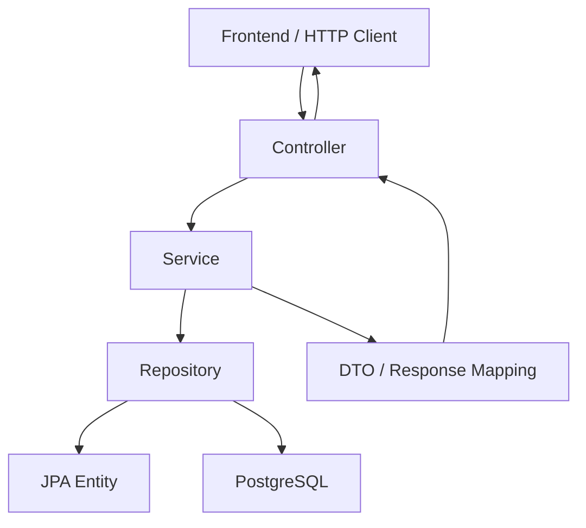

### Interpretation

Example:

```text
POST /api/jobs
        ↓
JobController
        ↓
JobService
        ↓
JobRepository
        ↓
Job entity
        ↓
PostgreSQL
```

The controller should **not** directly call the repository.

Bad:

```text
JobController → JobRepository
```

Preferred:

```text
JobController → JobService → JobRepository
```

---

# 11. CLASS INTERACTION DIAGRAM — AUTHENTICATION

Current authentication flow:

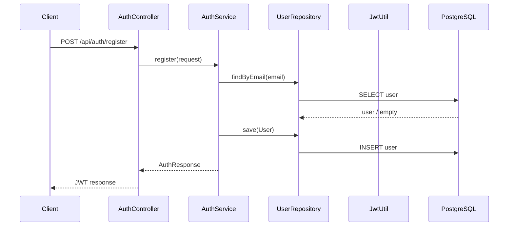

Login:

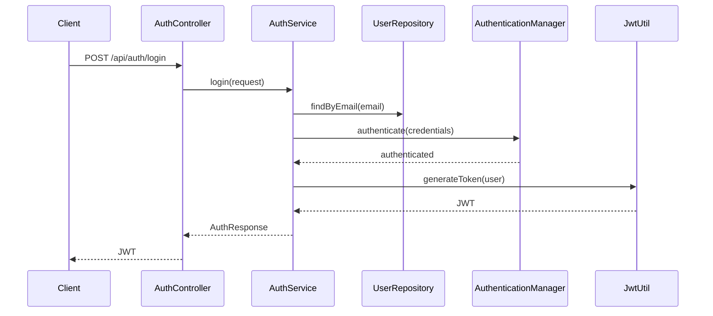

For protected requests:

```text
Client
  ↓ Authorization: Bearer JWT
JwtAuthFilter
  ↓
JwtUtil
  ↓
UserDetailsServiceImpl
  ↓
SecurityContext
  ↓
Controller
```

Do not create another authentication mechanism.

---

# 12. CLASS INTERACTION DIAGRAM — JOB CREATION

Recruiter creates a job:

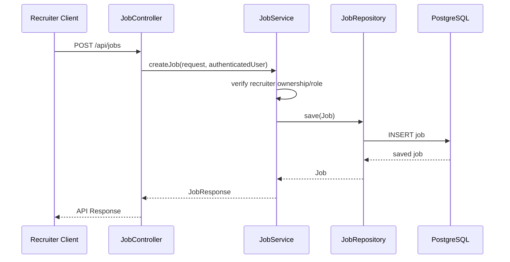

Rules:

- Controller receives request.
- Spring Security provides authenticated identity.
- Service validates business rules.
- Service creates the entity.
- Repository persists it.
- Controller returns DTO/response.

---

# 13. CLASS INTERACTION DIAGRAM — CANDIDATE APPLICATION

Candidate applies to a job:

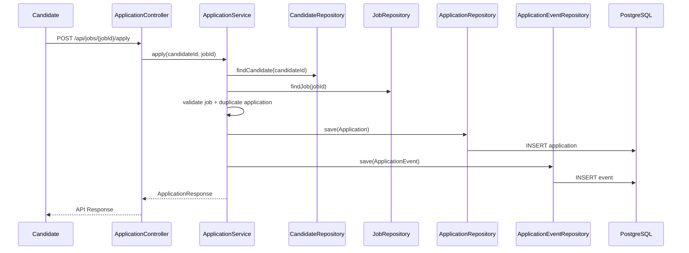

The service owns the workflow.

The controller should not contain the application state logic.

---

# 14. CLASS INTERACTION DIAGRAM — RECRUITER APPLICANT REVIEW

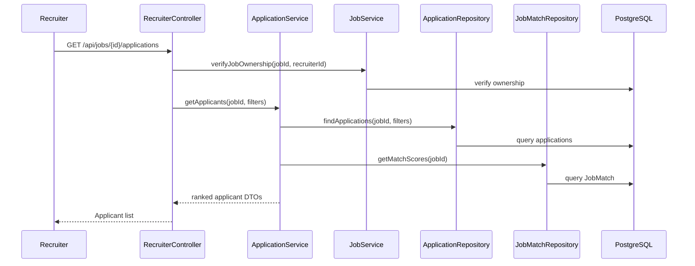

The recruiter must never be able to query applicants belonging to another recruiter's job.

---

# 15. RESUME PROCESSING WORKFLOW

The intended flow:

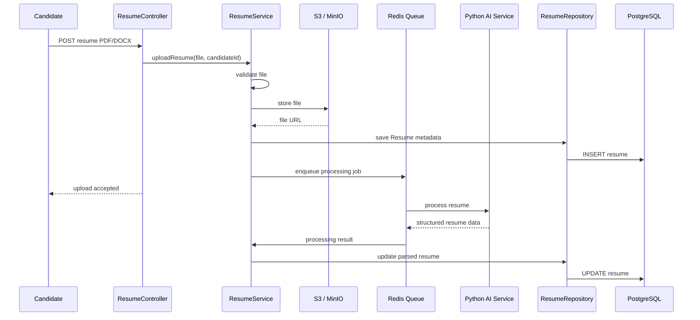

Long-running AI work should not unnecessarily block the upload request.

---

# 16. JAVA ↔ PYTHON INTERACTION

The boundary is:

```text
Spring Boot
    │
    │ HTTP / JSON
    ▼
Python / FastAPI
```

The Python service should not know about JPA entities.

Java should send a dedicated request DTO.

Python should return a dedicated response schema.

Conceptually:

```text
ResumeService
      ↓
AiServiceClient
      ↓
Python /parse-resume
      ↓
ResumeAnalysisResponse
      ↓
ResumeService
      ↓
Candidate/Resume repositories
```

Do not do:

```text
ResumeService
      ↓
Raw HTTP code everywhere
```

Centralize the Python communication in an AI client/service.

---

# 17. JAVA / PYTHON CONTRACT RULE

Before implementing a client:

```text
1. Confirm endpoint.
2. Confirm request JSON.
3. Confirm response JSON.
4. Confirm nullable fields.
5. Confirm error format.
6. Confirm timeout behavior.
7. Confirm embedding dimension.
```

The current schema has `vector(384)` columns.

The repository README notes that this assumes a 384-dimensional model and must be confirmed against the actual Python embedding model before Stage 2.

**Do not silently assume 384 is correct.**

---

# 18. RESUME DATA FLOW

```text
Resume File
    ↓
ResumeController
    ↓
ResumeService
    ├── File validation
    ├── Storage
    ├── Resume metadata
    └── Queue
            ↓
       Python AI Service
            ↓
       Parsed Resume
            ↓
ResumeService
    ├── ResumeRepository
    ├── CandidateSkillRepository
    └── CandidateProfileService
            ↓
        PostgreSQL
```

---

# 19. MATCHING ENGINE — STAGE 1

Stage 1 is deliberately simple.

Flow:

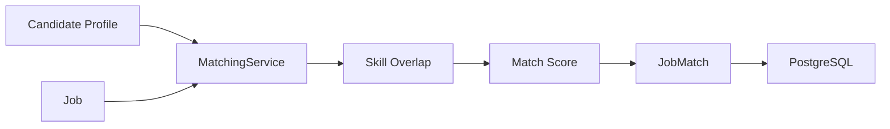

Java owns the basic scoring logic.

Use:

```text
Skill overlap
+
Role relevance
+
Basic experience compatibility
```

Do not introduce embeddings into Stage 1 unless explicitly requested.

---

# 20. MATCHING ENGINE — STAGE 2

Stage 2:

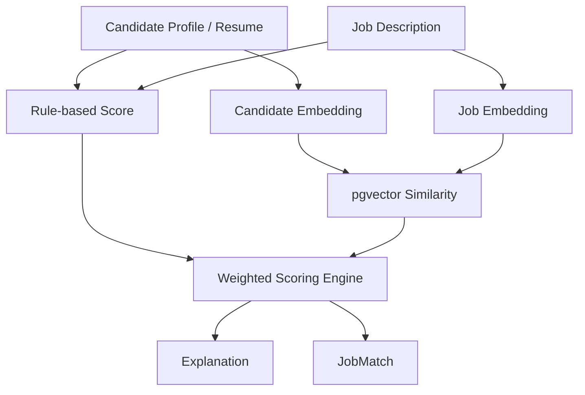

Reference weights:

```text
Required Skills       30%
Experience            20%
Projects              15%
Role Relevance        15%
Semantic Similarity   10%
Education/Certs       10%
```

Weights should be configurable.

Store:

```text
score
matchedSkills
missingSkills
explanation
```

---

# 21. APPLICATION STATE MACHINE

Valid states:

```text
SAVED
APPLIED
UNDER_REVIEW
SHORTLISTED
INTERVIEW
SELECTED
REJECTED
WITHDRAWN
```

Conceptual class interaction:

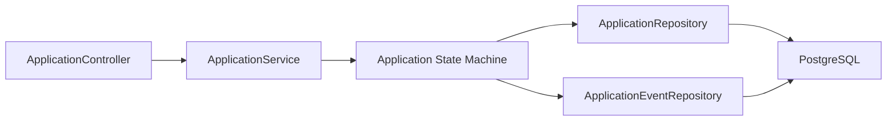

Every meaningful transition creates an `ApplicationEvent`.

Do not put state-transition rules inside the controller.

---

# 22. RECRUITER RANKING WORKFLOW

```text
Recruiter opens Job
        ↓
Verify Job Ownership
        ↓
Load Applications
        ↓
Load JobMatch records
        ↓
Apply filters
        ↓
Sort by match score
        ↓
Build Applicant DTO
        ↓
Return recruiter dashboard data
```

Example:

```text
Candidate A → 96%
Candidate B → 91%
Candidate C → 87%
Candidate D → 81%
```

The ranking should include evidence.

---

# 23. ROLE RESPONSIBILITIES

## Candidate

Can:

- manage own profile
- upload resumes
- inspect resume analysis
- search jobs
- receive recommendations
- save jobs
- apply
- track applications
- later generate tailored application content

Cannot:

- create recruiter jobs
- view unrelated candidates
- modify recruiter data
- access admin endpoints

## Recruiter

Can:

- manage own recruiter/company profile
- create jobs
- edit own jobs
- publish/unpublish own jobs
- view applicants for own jobs
- rank/filter applicants
- update application status
- view recruitment analytics

Cannot:

- edit another recruiter's jobs
- access admin-only operations
- arbitrarily modify candidate data

## Admin

Can:

- manage users
- moderate jobs
- manage skills
- configure scoring
- view platform statistics
- perform administrative actions

---

# 24. JOB OWNERSHIP

This is mandatory.

For:

```text
PUT /api/jobs/{id}
DELETE /api/jobs/{id}
GET /api/jobs/{id}/applications
```

the service must verify:

```text
authenticated user
        ↓
RecruiterProfile
        ↓
Job.recruiterId
```

If the job does not belong to that recruiter:

```text
403 FORBIDDEN
```

Never rely solely on the frontend.

---

# 25. API DESIGN

Prefer:

```text
GET    /api/jobs                      (public, published only)
GET    /api/jobs/{id}                 (public)
GET    /api/jobs/mine                 (RECRUITER, own jobs incl. drafts)

POST   /api/jobs                      (RECRUITER)
PUT    /api/jobs/{id}                 (RECRUITER, own job only)
DELETE /api/jobs/{id}                 (RECRUITER, own job only)
PATCH  /api/jobs/{id}/publish         (RECRUITER, own job only)
PATCH  /api/jobs/{id}/unpublish       (RECRUITER, own job only)

POST   /api/jobs/{id}/apply
POST   /api/jobs/{id}/save

GET    /api/jobs/{id}/applications
PATCH  /api/applications/{id}/status
```

Job endpoints live under a single `/api/jobs` prefix, not a separate `/api/recruiter/jobs` namespace — recruiter-only write access is enforced with `@PreAuthorize` and ownership checks inside `JobService`, not by splitting the URL path. Follow this same convention when adding new endpoints.

Use DTOs.

Do not return JPA entities directly.

---

# 26. DATABASE MIGRATION RULES

The repository uses:

```text
spring.jpa.hibernate.ddl-auto=validate
```

Therefore:

**Schema changes must be made through Flyway migrations.**

Examples:

```text
V2__add_candidate_indexes.sql
V3__add_job_status.sql
V4__add_resume_processing_status.sql
```

Do not use Hibernate auto-DDL to mutate the schema.

Before changing an entity:

```text
Entity
↓
Migration
↓
Repository
↓
Service
↓
DTO
↓
Controller
↓
Tests
```

---

# 27. TESTING RULES

The Maven project already includes:

```text
spring-boot-starter-test
spring-security-test
H2
```

Use them.

Every meaningful feature should have tests.

## Minimum tests

### Authentication

```text
register valid user
reject duplicate email
login valid credentials
reject invalid credentials
JWT-protected endpoint
role restriction
```

### Job

```text
recruiter creates job
recruiter updates own job
recruiter cannot update another recruiter's job
candidate can read allowed jobs
```

### Application

```text
candidate can apply
duplicate application rejected
status transition valid
invalid status transition rejected
event created
```

### Matching

```text
skill overlap calculated
missing skills identified
score bounded correctly
```

---

# 28. DEFINITION OF DONE

A feature is not done because it compiles.

For backend features:

```text
[ ] PRD requirement identified
[ ] Correct development stage
[ ] Existing code inspected
[ ] Entity added/updated if required
[ ] Flyway migration added if schema changes
[ ] DTOs implemented
[ ] Repository implemented
[ ] Service implemented
[ ] Controller implemented
[ ] Authorization verified
[ ] Ownership checks verified
[ ] Validation added
[ ] Exceptions handled
[ ] Tests added
[ ] Existing tests still pass
[ ] Build passes
[ ] API behavior verified
```

For Java ↔ Python features:

```text
[ ] Request contract confirmed
[ ] Response contract confirmed
[ ] Error contract confirmed
[ ] Timeout behavior confirmed
[ ] Both services tested together
[ ] Docker Compose tested
```

---

# 29. SECURITY RULES

Never:

- store plaintext passwords
- log passwords
- log JWTs
- expose password hashes
- expose private resumes publicly
- store third-party passwords
- trust frontend-only authorization
- allow cross-recruiter access
- bypass validation for convenience

Always:

- enforce RBAC server-side
- enforce resource ownership
- validate uploads
- use environment variables for secrets
- use global exception handling
- maintain audit logs
- protect private candidate information

---

# 30. AI RELIABILITY

Separate:

```text
Verified User Data
AI-Extracted Data
AI-Generated Data
```

Example:

```text
Verified:
Candidate manually entered Java.

AI-extracted:
Resume appears to contain Docker.

AI-generated:
Cover-letter paragraph.
```

Do not silently convert AI output into verified facts.

AI recommendations must be grounded in:

- resume data
- job requirements
- candidate skills
- projects
- experience
- scoring factors
- semantic similarity

---

# 31. PERFORMANCE

Do not optimize prematurely.

First:

```text
Correct
↓
Tested
↓
Measured
↓
Optimized
```

Likely expensive operations:

```text
PDF parsing
LLM calls
Embedding generation
Vector similarity
External job ingestion
Large applicant lists
```

Use:

- Redis/background jobs
- pagination
- database filtering
- indexes
- appropriate query design

Do not load thousands of applicants into Java memory if PostgreSQL can filter/sort them.

---

# 32. EXTERNAL JOB APIs

External APIs are optional job sources.

The architecture must be:

```text
                ┌── Recruiter Jobs
                │
Job Sources ────┼── External APIs
                │
                └── Internal Demo Jobs
                         ↓
                    Common Job Model
                         ↓
                    Matching Engine
```

Do not build:

```text
External API
    ↓
Entire Platform
```

If the external provider fails, recruiter-created jobs must still function.

---

# 33. THREE DEVELOPMENT STAGES

## Stage 1 — IT WORKS

Implement:

```text
Authentication
RBAC
Candidate profile
Recruiter profile
Company
Resume upload
Basic resume parsing
Basic skill extraction
Basic score
Recruiter job CRUD
Job search
Rule-based matching
Recommendations
Applications
Application tracking
Recruiter applicant list
Basic admin
```

Stage 1 success:

```text
Candidate registers
→ uploads resume
→ sees analysis
→ finds matching job
→ applies

Recruiter registers
→ creates job
→ sees applicant
→ updates status

Candidate sees updated status
```

## Stage 2 — IT IS SMART

Implement:

```text
Semantic embeddings
Skill normalization
pgvector
Explainable weighted matching
Skill-gap analysis
Resume optimization
Cover letters
Candidate ranking
Recruiter filtering
Recruiter analytics
Evaluation dataset
Precision@K
Recall@K
NDCG
F1 where appropriate
```

Stage 2 success:

> The system explains why a candidate matches a job and why applicants rank differently.

## Stage 3 — IT IS AUTOMATED

Implement:

```text
Application workflow engine
Profile → application field mapping
Required-field validation
Automatic application rules
Duplicate protection
Application event logging
Notifications
Advanced analytics
Recruitment pipeline
Controlled auto-apply on project-owned portal
Authorized integrations only
```

Stage 3 success:

> A complete controlled application workflow can be executed, validated, logged, and protected against duplicate submission.

---

# 34. AGENT WORKFLOW FOR EVERY CODING TASK

When the user asks for a feature:

## Step 1 — Understand

Identify:

```text
What is being requested?
Which PRD requirement?
Which stage?
Which module?
Which existing classes are affected?
```

## Step 2 — Inspect

Inspect:

```text
existing entity
existing repository
existing service
existing controller
existing DTO
existing migration
existing security rules
existing tests
```

Never assume a file does not exist.

## Step 3 — Explain the class interaction

Before a significant implementation, be able to state:

```text
Controller
    calls
Service
    calls
Repository
    accesses
Entity / Database
```

If Python is involved:

```text
Service
    calls
AI Client
    calls
Python endpoint
    returns
AI response DTO
    goes back to
Service
```

## Step 4 — Implement smallest correct change

Do not refactor unrelated code.

## Step 5 — Test

Run relevant tests/build.

## Step 6 — Verify

Check:

- endpoint
- authorization
- ownership
- database persistence
- response
- error cases

## Step 7 — Explain

Report:

```text
What changed
Which classes interact
How the request flows
What was tested
Any remaining limitation
```

---

# 35. WHEN DEBUGGING

Do not immediately rewrite the code.

Trace the flow:

```text
Request
 ↓
Controller
 ↓
Service
 ↓
Repository
 ↓
Database
```

If AI-related:

```text
Request
 ↓
Controller
 ↓
Service
 ↓
AI Client
 ↓
Python
 ↓
AI result
 ↓
Service
 ↓
Repository
```

Find where the data becomes incorrect.

Then fix the smallest broken layer.

---

# 36. WHEN CREATING A NEW CLASS

Before creating it, answer:

```text
Why does this class exist?
Who calls it?
What does it own?
What does it depend on?
Should it be Controller / Service / Repository / DTO / Entity / Client?
```

Examples:

```text
JobController
→ HTTP/API concerns

JobService
→ Job business rules

JobRepository
→ Persistence

Job
→ Database/domain state

JobRequest
→ Incoming API data

JobResponse
→ Outgoing API data

AiServiceClient
→ Java ↔ Python communication
```

Do not put all behavior into the entity.

---

# 37. WHEN CREATING A NEW ENDPOINT

Trace it:

```text
HTTP
 ↓
Controller method
 ↓
Request DTO
 ↓
Service method
 ↓
Business validation
 ↓
Repository
 ↓
Database
 ↓
Response DTO
 ↓
HTTP
```

Security must be checked at the endpoint and/or service boundary.

Ownership must be checked before modifying resources.

---

# 38. WHEN CHANGING AN EXISTING CLASS

Before editing:

```text
Who uses this class?
What endpoints depend on it?
What tests depend on it?
Does Python depend on its output?
Does the database schema depend on it?
```

Do not break existing auth/security behavior while adding unrelated features.

---

# 39. DO NOT OVER-ENGINEER

Avoid premature:

- microservices
- event buses everywhere
- unnecessary interfaces
- generic repositories
- complex factories
- unnecessary design patterns
- advanced caching
- speculative abstractions

Use the simplest architecture that satisfies the PRD.

The Python service is already a deliberate service boundary. Do not turn every Spring feature into a separate service.

---

# 40. GIT RULES

Prefer focused commits:

```text
feat(profile): add candidate profile CRUD
feat(job): add recruiter job CRUD
feat(resume): add resume upload
feat(application): add application state machine
feat(matching): add stage 1 skill overlap scoring
fix(job): enforce recruiter job ownership
test(application): add state transition tests
```

Avoid:

```text
final changes
update everything
stuff
working now
```

Do not mix unrelated features unnecessarily.

---

# 41. CONFIGURATION

Never hard-code:

```text
database passwords
JWT secrets
API keys
AI service URLs
S3 credentials
Redis credentials
```

Use configuration/environment variables.

Existing configuration should be reused where possible.

---

# 42. REPOSITORY-SPECIFIC DO NOT-TOUCH RULES

Unless explicitly requested:

1. Do not replace the existing authentication architecture.
2. Do not replace JWT.
3. Do not replace Spring Security.
4. Do not replace PostgreSQL.
5. Do not replace Flyway.
6. Do not replace Redis.
7. Do not remove MinIO/S3 support.
8. Do not remove pgvector.
9. Do not rewrite `SecurityConfig` unnecessarily.
10. Do not recreate `User`.
11. Do not recreate `Role`.
12. Do not create a second response wrapper.
13. Do not bypass `GlobalExceptionHandler`.
14. Do not replace the existing Maven structure.
15. Do not recreate the V1 schema from scratch.
16. Do not directly connect Python to PostgreSQL.

If an existing component genuinely needs modification, make the smallest compatible change.

---

# 43. IMPORTANT CURRENT REPOSITORY NOTES

The repository README states:

- `/api/jobs/**` is currently left publicly readable.
- Job write operations must be protected with recruiter authorization as they are implemented.
- `spring.jpa.hibernate.ddl-auto` is `validate`.
- Schema changes must go through Flyway.
- `WebClient` is already available for the future Python service.
- S3 SDK is already available and configured toward local MinIO.
- Redis is already included for async resume processing.
- pgvector columns already exist for future semantic matching.

Preserve these design decisions unless the user explicitly asks to change them.

---

# 44. FINAL CLASS-INTERACTION REFERENCE

Use this as the mental model for the backend:

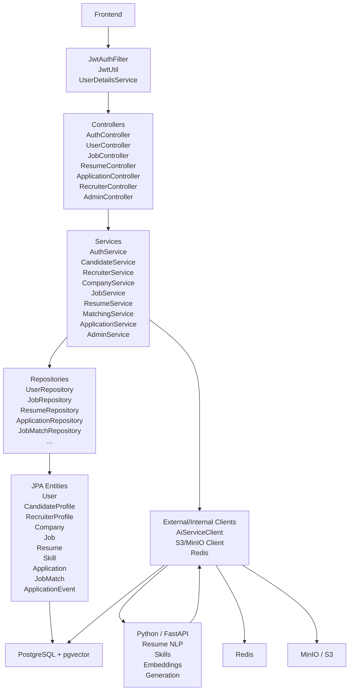

### The fundamental rule

```text
Controller
    ↓
Service
    ↓
Repository
    ↓
Database
```

For external AI:

```text
Controller
    ↓
Service
    ↓
AI Client
    ↓
Python
    ↓
AI Client
    ↓
Service
    ↓
Repository
    ↓
Database
```

If a new implementation violates this flow, explain why before introducing it.

---

# 45. FINAL GOVERNING PRINCIPLE

The project must evolve:

```text
                    ┌─────────────────┐
                    │    STAGE 1      │
                    │   IT WORKS      │
                    │                 │
                    │ Stable backend  │
                    │ + database      │
                    │ + CRUD          │
                    │ + applications  │
                    └────────┬────────┘
                             ↓
                    ┌─────────────────┐
                    │    STAGE 2      │
                    │   IT IS SMART   │
                    │                 │
                    │ Semantic AI     │
                    │ Matching        │
                    │ Ranking         │
                    │ Explanations    │
                    └────────┬────────┘
                             ↓
                    ┌─────────────────┐
                    │    STAGE 3      │
                    │ IT IS AUTOMATED │
                    │                 │
                    │ Workflows       │
                    │ Rules           │
                    │ Analytics       │
                    │ Controlled      │
                    │ Auto-Apply      │
                    └─────────────────┘
```

**Do not optimize for the fanciest implementation. Optimize for a working, understandable, testable system that can progressively become intelligent and automated.**
